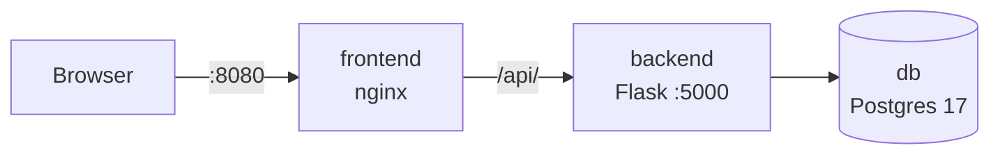

# FestPass: containerised three-tier app

Three-tier app containerised with Docker Compose, scanned with Trivy (236 CRITICAL findings down to 0), published to Docker Hub and signed with cosign. 
The app is a registration page for a tech fest.

The project focuses on the software supply chain: build the image, scan it, publish it, and prove it is the one I built.

## Architecture



| Tier | Technology | Image |
|---|---|---|
| Frontend | Static HTML served by nginx, also a reverse proxy for `/api/` | `nginx:1.30-alpine` |
| Backend | Python Flask API | built from `backend/Dockerfile` |
| Database | PostgreSQL, data kept in a named volume | `postgres:17-alpine` |

Two Docker networks separate the tiers:

- `frontend-net`: frontend and backend
- `backend-net`: backend and db

Only the backend sits on both, so it is the only bridge. The frontend cannot reach the database.

## Run it locally

Requirements: Docker with Compose.

```powershell
# 1. create your own secrets file (it is git-ignored)
Copy-Item .env.example .env
# edit .env and set a real DB_PASSWORD

# 2. build and start everything
docker compose up -d --build

# 3. open the app
# http://localhost:8080
```

Stop it with `docker compose down`. Add `-v` only if you also want to delete the database volume.

## Project layout

```
.
|-- compose.yaml
|-- .env.example
|-- backend/
|   |-- app.py
|   |-- requirements.txt
|   |-- Dockerfile
|   `-- .dockerignore
|-- frontend/
|   |-- index.html
|   `-- nginx.conf
|-- reports/        (Trivy scan reports)
`-- screenshots/
```

## Progress

- [x] Phase 1: containerise the backend
- [x] Phase 2: compose the three-tier stack
- [x] Phase 3: scan with Trivy and fix the findings
- [x] Phase 4: version and publish to Docker Hub
- [x] Phase 5: sign with cosign and verify
- [x] Phase 6: final write-up

## Phase 1: backend image

The first image uses `python:3.9`, deliberately old, to give the scanner something to find in Phase 3.

- Dependencies are installed before the code is copied, so editing `app.py` reuses the cached `pip install` layer.
- Image `fest-backend:0.1` is **1.61 GB** on disk (412 MB compressed).
- `GET /api/health` returns `"database": false` when run alone, which is expected without a database.

## Phase 2: findings

**Network isolation.** From inside the frontend container:

```
$ docker compose exec frontend ping -c 1 db
ping: bad address 'db'

$ docker compose exec frontend wget -qO- http://backend:5000/api/health
{"container":"...","database":true,"service":"festpass-backend","version":"dev"}
```

The frontend cannot even resolve the name `db`, because it shares no network with the database. It can reach the backend, and the backend reports a working database connection.

**Design choices.**

- The database password lives only in `.env`, which is git-ignored. `.env.example` is the committed template.
- The backend starts only after Postgres passes a `pg_isready` healthcheck, not merely after the container starts.
- Only the frontend publishes a port. The backend and database are not reachable from the host.
- The nginx config and `index.html` are bind-mounted read-only.

**Persistence.**

- [x] Registrations survive `docker compose down` followed by `docker compose up -d`

## Phase 3: scan and fix

Scanner: Trivy. The first image used `python:3.9`, which is end-of-life, so its Debian layer was stuck at 13.1.

| | 0.1 (before) | 0.2 (after) |
|---|---|---|
| Base image | python:3.9 (Debian 13.1) | python:3.13-slim (Debian 13.8) |
| CRITICAL | 236 | 0 |
| HIGH | 2,677 | 58 |
| Image size | 1.61 GB | 208 MB |
| Runs as | root | appuser (uid 10001) |
| Flask / Werkzeug | 2.2.2 / 2.2.2 | 3.1.3 / 3.1.9 |

Counting only findings that have a fix available, the 0.1 image had 233 CRITICAL and 2,485 HIGH.

Gate check, exit code 0 means no fixable CRITICAL:

```
trivy image --severity CRITICAL --ignore-unfixed --exit-code 1 fest-backend:0.2
```

**What changed and why.** A newer slim base image removed most findings in one step, because the OS layer was the source of almost all of them. Flask and Werkzeug were upgraded to the highest fixed versions the scan listed. The app now runs as a non-root user.

**Known remaining findings.**

- Some Debian packages are marked `affected` or `fix_deferred`, meaning no patched version exists yet. They will clear on a future rebuild.
- The remaining Python HIGH findings are in libraries bundled inside pip itself (urllib3 and msgpack, confirmed under `pip/_vendor`, and setuptools 70.3.0, listed in pip's `vendor.txt`). They are not in `requirements.txt`, so they cannot be upgraded from this project. Risk is low because pip only runs at build time and nothing at runtime calls it. Accepted and documented.


## Phase 4: published to Docker Hub

Image: https://hub.docker.com/r/icyyharsh/fest-backend

| Tag | Meaning |
|---|---|
| `1.0.0` | exact release |
| `1.0` | moving pointer to the newest 1.0.x |

Never `latest`: it says nothing about what you are running.

Digest of 1.0.0 as pushed: sha256:3cb4e4b41f5d9c0c922d87195aefa708214d4e0859d494c619713bd8c05a1291

The version is passed at build time (`--build-arg APP_VERSION=1.0.0`) and stored in the image, so the page shows which backend is running.


## Phase 5: signing with cosign

Images are signed by digest with a cosign key pair. The public key (`cosign.pub`) is in this repo. The private key stays on my machine and is git-ignored.

```
cosign verify --key cosign.pub icyyharsh/fest-backend@sha256:3cb4e4b41f5d9c0c922d87195aefa708214d4e0859d494c619713bd8c05a1291
```

| Release | Signed | `cosign verify` |
|---|---|---|
| 1.0.0 | yes | passes |
| 1.0.1 | no | rejected: no signature found |

The signature belongs to the digest, not the tag, so retagging cannot make an unsigned image look signed.

Docker Content Trust (`docker trust`) is being retired, so cosign is used instead.


## What I learned

**Scanning and fixing**

- Almost all the vulnerabilities came from the base image, not from my code. `python:3.9` is end-of-life, so its Debian layer was stuck at 13.1. Moving to `python:3.13-slim` (Debian 13.8) took the image from 236 CRITICAL findings to 0 and from 1.61 GB to 208 MB. One base-image change did more than all the library upgrades combined.
- The "Fixed Version" column tells you where the fix lives. A PyPI-style version (like Werkzeug 3.1.9) means change `requirements.txt`. A Debian-style version means change the base image.
- Not every finding is mine to fix. The remaining Python HIGH findings are libraries bundled inside pip itself (I confirmed their location under `pip/_vendor`). pip only runs at build time, so I accepted and documented them instead of chasing them.
- `--ignore-unfixed` is what makes a scan usable as a pass/fail gate. Findings marked `affected` or `fix_deferred` have no patch yet, so failing a build over them would just be noise.

**Building the image**

- Layer order matters for caching: dependencies are installed before the code is copied, so a code change doesn't reinstall every library.
- An image is a snapshot. Editing `app.py` did not change a container that was already built or running. I had to rebuild.
- Running as a non-root user costs two lines and limits what an attacker gets if the app is compromised.

**Compose and networking**

- Two networks enforce "only the backend talks to the database". I proved it instead of assuming it: `ping db` fails from the frontend and the backend still reaches the database.
- Compose names a project after its folder, so two copies of a project in same-named folders can share volumes. I use `-p` for throwaway test stacks.

**Publishing and signing**

- A tag is a movable label. A digest is a fingerprint of the exact contents. That is why I sign the digest, not the tag.
- Docker Hub accepts any image I push, signed or not. Signing does not block anything. It lets someone detect an image I did not sign, but only if they run `cosign verify`.
- My Docker Hub login and my cosign private key are separate secrets. Stealing one does not give an attacker the other, and that is the point of signing.
- Secrets stay out of Git. `.env` and `cosign.key` are ignored, and I searched the full history to confirm neither was ever committed. A fresh clone from GitHub is the real test that the repo is complete.

## What I would do next

- Run the backend with a production server such as gunicorn instead of Flask's built-in development server (the container logs warn about this).
- Add a deploy step that runs `cosign verify` and only then runs `docker compose up`, so verification is enforced, not optional.
- Rebuild and rescan on a schedule, since new vulnerabilities are published every day.
