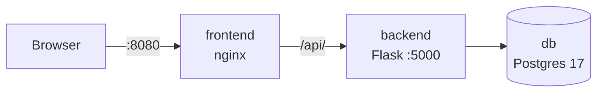

# FestPass: containerised three-tier app

A hands-on DevOps project that takes a small web app from "runs on a laptop" to a scanned, versioned and signed container image. The app is a registration page for a tech fest.

The project focuses on the software supply chain: build the image, scan it, publish it, and prove it is the one I built.

## Architecture



| Tier | Technology | Image |
|---|---|---|
| Frontend | Static HTML served by nginx, also a reverse proxy for `/api/` | `nginx:1.30-alpine` |
| Backend | Python Flask API | built from `backend/Dockerfile` |
| Database | PostgreSQL, data kept in a named volume | `postgres:17-alpine` |

Two Docker networks separate the tiers:

- `frontend-net`: frontend and backend
- `backend-net`: backend and db

Only the backend sits on both, so it is the only bridge. The frontend cannot reach the database.

## Run it locally

Requirements: Docker with Compose.

```powershell
# 1. create your own secrets file (it is git-ignored)
Copy-Item .env.example .env
# edit .env and set a real DB_PASSWORD

# 2. build and start everything
docker compose up -d --build

# 3. open the app
# http://localhost:8080
```

Stop it with `docker compose down`. Add `-v` only if you also want to delete the database volume.

## Project layout

```
.
|-- compose.yaml
|-- .env.example
|-- backend/
|   |-- app.py
|   |-- requirements.txt
|   |-- Dockerfile
|   `-- .dockerignore
|-- frontend/
|   |-- index.html
|   `-- nginx.conf
|-- reports/        (Trivy scan reports)
`-- screenshots/
```

## Progress

- [x] Phase 1: containerise the backend
- [x] Phase 2: compose the three-tier stack
- [ ] Phase 3: scan with Trivy and fix the findings
- [ ] Phase 4: version and publish to Docker Hub
- [ ] Phase 5: sign with cosign and verify
- [ ] Phase 6: final write-up

## Phase 1: backend image

The first image uses `python:3.9`, deliberately old, to give the scanner something to find in Phase 3.

- Dependencies are installed before the code is copied, so editing `app.py` reuses the cached `pip install` layer.
- Image `fest-backend:0.1` is **1.61 GB** on disk (412 MB compressed).
- `GET /api/health` returns `"database": false` when run alone, which is expected without a database.

## Phase 2: findings

**Network isolation.** From inside the frontend container:

```
$ docker compose exec frontend ping -c 1 db
ping: bad address 'db'

$ docker compose exec frontend wget -qO- http://backend:5000/api/health
{"container":"...","database":true,"service":"festpass-backend","version":"dev"}
```

The frontend cannot even resolve the name `db`, because it shares no network with the database. It can reach the backend, and the backend reports a working database connection.

**Design choices.**

- The database password lives only in `.env`, which is git-ignored. `.env.example` is the committed template.
- The backend starts only after Postgres passes a `pg_isready` healthcheck, not merely after the container starts.
- Only the frontend publishes a port. The backend and database are not reachable from the host.
- The nginx config and `index.html` are bind-mounted read-only.

**Persistence.**

- [x] Registrations survive `docker compose down` followed by `docker compose up -d`
